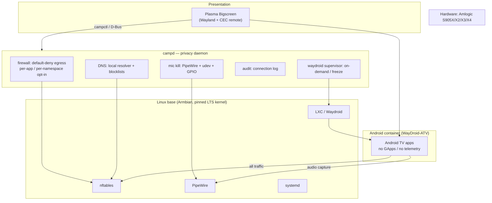

# campOS Architecture

## Overview

campOS is a Linux distribution for smart TVs and TV boxes that treats network
privacy as a hard guarantee rather than a setting. It runs on unlockable
Amlogic-class boxes (v1), provides a couch-friendly TV interface (Plasma
Bigscreen), and runs Android apps in a Waydroid container that only exists
while an Android app is in use.

## Layers

## The privacy guarantee

The core invariant: **no packet leaves the device unless a rule allows it.**

1. `nftables` output chain ships with `policy drop`.
2. Baseline allows: loopback, DHCP, DNS to the local resolver, established
   connections.
3. Everything else (including the Android container's network namespace) is
   denied until the user grants it — per app or per destination, from the
   settings UI or `campctl`.
4. Every denied connection is recorded in the audit log, so users can *see*
   what their apps attempted, which doubles as a transparency feature
   (the exact opposite of the LG/ACR model).

## Component responsibilities

| Component | Responsibility |
|-----------|----------------|
| **Plasma Bigscreen** | 10-foot UI, CEC remote input, settings surface, app launching |
| **campd** | Owns firewall state, mic kill state, DNS config, audit log, Waydroid lifecycle; exposes `campctl` CLI and a D-Bus API (future) |
| **Waydroid supervisor** | Starts the Android container only when an Android app is launched; freezes it on exit; loads `binder_linux` only while active |
| **campctl** | Operator CLI: `status`, `firewall apply/allow`, `mic on/off`, `factory-reset` |
| **Reset agent** | A/B slot management, OTA apply, userdata wipe |
| **Armbian base** | Kernel, drivers, boot for Amlogic boxes; pinned LTS kernel for Waydroid binder stability |

## Boot & install model

- v1 install: boot campOS image from SD/USB via the Amlogic toothpick reset
  button (vendor u-boot, no chain-loaded bootloader, no brick risk).
- Once installed to eMMC: A/B slots for rootfs; recovery = boot alternate slot
  or removable media.
- Factory reset: wipes `/data` (including Waydroid userdata), rolls back to
  the other slot if the current one is unhealthy.

## Trust boundaries

| Boundary | Enforcement |
|----------|-------------|
| campOS ↔ network | nftables default-deny, rules only via campd |
| campOS ↔ Android container | Container runs unprivileged; all its traffic hits the host firewall as its own namespace/uid range |
| Android apps ↔ mic | Mic kill removes the PipeWire source *and* unbinds the udev device; Waydroid gets no device node to open |
| User ↔ reset | `factory-reset` requires explicit confirmation; recovery path works without a functional UI |

## Non-functional targets

- Idle RAM: < 400 MB without Android container; < 900 MB with a frozen container
- Boot to UI: < 20 s on S905X3
- Supported RAM: 1 GB minimum, 2 GB recommended
- Kernel: pinned LTS (6.12) with `binder_linux` as module

## Known risks

| Risk | Mitigation |
|------|-----------|
| Mali GPU/video decode gaps on mainline | Tier-1 = S905X2/X3 (Mali-G31/G52); device matrix in P4 |
| Waydroid vs new-kernel Rust binder regressions | Pin LTS kernel; load binder on demand |
| Cheap-box WiFi drivers | Prefer Ethernet boxes for v1; tested-dongle list |
| Scope creep (solo maintainer) | Ship P0–P2 before UI polish |
